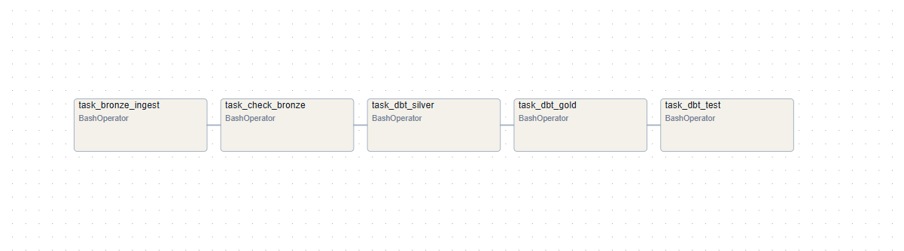
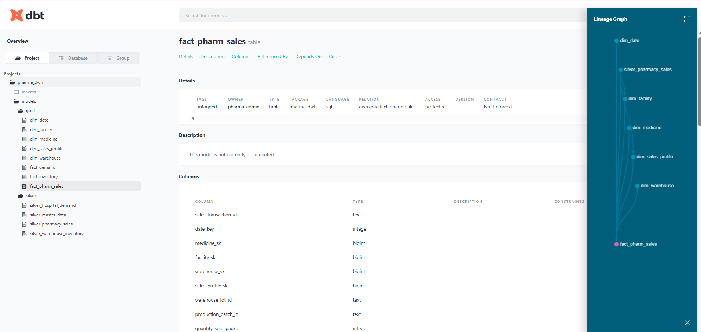
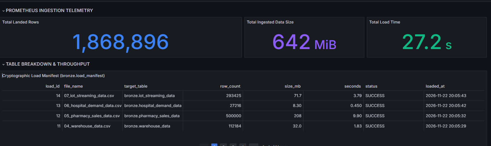
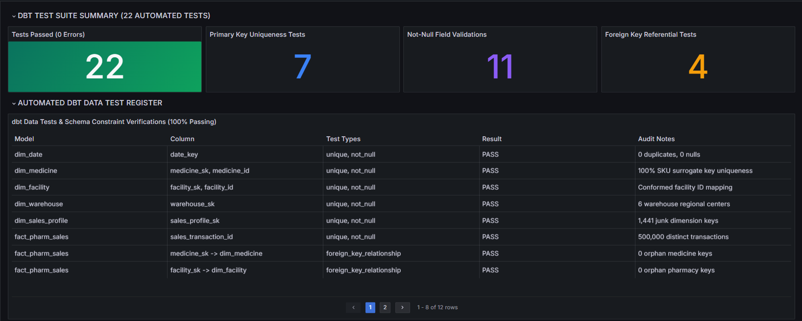

<h1 align="center">🧊 pharma-coldchain-dwh</h1>

<p align="center">
  <i>934,448 rows in. One star schema out. Zero rows harmed.</i>
</p>

<p align="center">
  
  
  
  
  
  
  
</p>

A medallion-architecture data warehouse for a pharmaceutical cold-chain network.
Raw CSVs go in, get verified, cleaned, modelled into a Kimball star schema, and watched by Grafana.
Everything runs from one `docker compose`.

> **Phase 1:** Sales & Demand Intelligence (SDI) Mart · Data Analytics & Warehousing, Fall 2026

## `$ cat pipeline.txt`

```
 7 CSVs ──► 🟫 bronze ──► ⬜ silver ──► 🟦 gold ──► 📊 grafana
 (SHA-256)   raw COPY      dbt views    dbt tables   5 dashboards
               │                                        ▲
               └────── Airflow: dag_mart_sdi ───────────┘
        ingest → check → dbt silver → dbt gold → dbt test
```

| Layer | Tech | What happens |
|:------|:-----|:-------------|
| 🟫 **Bronze** | Python + `COPY` | Immutable raw landing zone, checksummed |
| ⬜ **Silver** | dbt (views) | Type-cast, null-cleaned, deduplicated |
| 🟦 **Gold** | dbt (tables) | 3 facts + 5 dims, business logic lives here |
| 🎛️ **Orchestration** | Airflow | One DAG, five dependent tasks |
| 📡 **Observability** | Prometheus · Pushgateway · Grafana | Every layer is monitored |

## `$ describe gold`

<p align="center">
  
</p>

## `$ make stats`

| Metric | Value |
|:-------|------:|
| Rows ingested | **934,448** (0 dropped, 0 modified) |
| dbt models passing | **12 / 12** |
| dbt tests passing | **22 / 22** |
| Hypotheses verified up front | **15 pass · 2 partial · 1 fail (by design)** |
| Source reconciliation | **100% exact** (units, hospital volume, revenue) |
| Net sales revenue | **$5,971,058.76** |
| Network FEFO compliance | **96.4%** |
| Q3' latency after indexing | 2,277.9 ms → 2,129.4 ms |

## `$ ./quickstart.sh`

Needs Docker Desktop (Compose v2.20+). Drop the 7 source CSVs into `data/source/` first.

```bash
git clone <repo-url> pharma_dwh && cd pharma_dwh

docker compose up -d postgres pushgateway prometheus grafana          # infra
docker compose run --rm tools python scripts/load_bronze.py --force   # bronze
docker compose run --rm tools bash -c "cd dbt && dbt run  --profiles-dir ."   # silver + gold
docker compose run --rm tools bash -c "cd dbt && dbt test --profiles-dir ."   # 22 tests
docker compose run --rm tools python scripts/run_bench.py             # Q1'–Q3'
docker compose run --rm tools python scripts/optimize_gold.py         # 10 indexes
docker compose run --rm tools python scripts/push_all_metrics.py      # → prometheus
```

| Service | URL |
|:--------|:----|
| Airflow | http://localhost:8080 |
| Grafana | http://localhost:3000 |
| Prometheus | http://localhost:9090 |
| Pushgateway | http://localhost:9091 |
| dbt Docs | http://localhost:8085 |

## `$ ls screenshots/`

| Airflow DAG | dbt Lineage |
|:-----------:|:-----------:|
|  |  |

| Grafana · Dashboards | Grafana · Ingestion|
|:-------------------:|:-----------------------:|
|  |  |

| Grafana · dbt Tests | 
|:-------------------:|
|  |

## `$ tree -L 1`

```
.
├── dags/               Airflow DAG (dag_mart_sdi.py)
├── dbt/                silver + gold models, macros, tests
├── scripts/            load_bronze · check_bronze · run_bench · optimize_gold · push_all_metrics
├── sql/ddl/            schemas: bronze silver gold dq obs
├── config/grafana/     5 provisioned dashboards
├── docs/               metrics.md · decisions/ (15 ADRs) · clean_clone_test.md
├── docker-compose.yml  9 services
└── Makefile
```

## Notes

- **Why Postgres, not DuckDB?** DuckDB is single-writer and can't serve Grafana reads while dbt writes. DuckDB is used only for the up-front data verification.
- **Source data is sacred.** SHA-256 checksums are locked at day 0 and written to `bronze.load_manifest` on every load.
- **SCD2 isn't in the source.** `dim_medicine` has the SCD2 columns and is proven with a test fixture instead.
- **Hospital double-counting trap.** 50,305 sales rows are hospital pharmacy; Q1' filters them out before comparing against hospital demand.
- **Averages lie.** Shelf life is pack-weighted: `SUM(DaysToExpiry × Qty) / SUM(Qty)`.

## 🧰 Stack

`PostgreSQL 16.4` · `dbt-postgres` · `Airflow 2.10.5` · `DuckDB` · `Prometheus 2.54.1` · `Pushgateway 1.9.0` · `Grafana 11.2.0` · `Docker Compose`

---

<p align="center"><sub>Built for the Pharma Cold-Chain DWH · Milestone 2 · 22 Nov 2026</sub></p>
